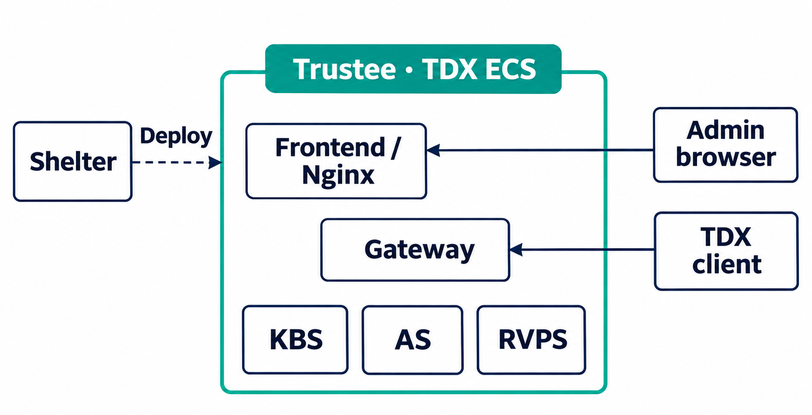

# Trustee on TDX ECS

图中实线表示逻辑调用。浏览器和 TDX 客户端的网络入口均为实例的 Nginx HTTPS 端口。Gateway 及其后端经实例内网栈通信。

| 位置 | 职责 |
| --- | --- |
| 构建和部署机 | Shelter 将 ALinux、Trustee、管理前端及 guest 配置构建为 UEFI 磁盘镜像。Terraform 将镜像上传 OSS、导入 ECS 并按 target 创建 TDX 实例。部署机本身可以是普通 ECS。 |
| Trustee TDVM | systemd 启动 RVPS、AS gRPC、AS REST、KBS 和 Gateway。独立的前端服务由 Nginx 提供 React 管理页面并代理 API。 |
| 管理浏览器 | 通过前端查询健康状态、管理资源、策略和参考值、查看实例和审计。浏览器在本地用管理私钥签发管理令牌，Nginx 对管理 API 请求使用 KBS 的公钥验证结果。 |
| TDX 客户端 | 使用 KBS challenge 生成与当前会话绑定的 TDX evidence。KBS 调用 AS 验证证据，按资源策略决定是否将加密的资源响应交给该客户端。 |

## 两次证明针对不同对象

部署方验证的是 **Trustee 所在的 TDVM**。默认 confidential target 要求部署方使用 guest 证据接口和独立批准的启动度量、TCB 策略验证实例。普通运行状态、HTTPS 能连通和 Gateway 健康响应均不提供这项证明。

取密时被验证的是 **发起请求的 TDX 客户端**。管理员先通过 Gateway 配置 RVPS 参考值、AS 证明策略和 KBS 资源策略，再登记资源。客户端通过 HTTPS 访问 KBS 协议，成功验收需要客户端解密本轮测试资源、比对摘要，并与服务端的证明记录对应。仅用于互操作测试的显式 external-authority 配置，其 Shelter 部署结果不含对服务端的独立 appraisal。

## 身份、数据和生命周期

管理公钥可随镜像分发。管理私钥、实例 HTTPS 私钥和 AS 签名私钥各自承担不同职责。首次启动生成实例 CA、HTTPS 证书和 AS 签名证书，KBS 用同一个实例 CA 验证 AS 令牌。签发后删除 CA 私钥。两张叶证书有效期一年，运维方须在到期前完成身份轮换并重新分发公共信任锚。通过 ECS 控制面获取 CA 时，证书来源信任包含该控制面。浏览器把管理私钥和令牌保存在本站点的 localStorage，管理员应使用受控浏览器并在结束后登出。

配方使用 Shelter baseline 磁盘，KBS 的 LocalFs 插件将资源保存到系统盘。TDX 硬件证明覆盖策略中指定的度量。系统盘和快照的静态加密、访问控制及可写根文件系统的完整性是独立的部署配置。

KBS 资源、AS 策略、RVPS 参考值及 Gateway 状态需要可写存储。停止再启动同一实例时须保留系统盘。销毁实例前按部署策略备份状态和需要延续的身份，重新建机后重新核验实例和证书。源镜像适合复用；已经启动并写入实例身份的系统盘不能作为其他实例的公共模板。

实现依据见 [Trustee 聚合服务](../dist/system/trustee.service)、[前端服务](../dist/system/trustee-frontend.service)、[RPM 包内容](../rpm/trustee.spec) 和 [Gateway API](../trustee-gateway/trustee_gateway_api.md)。部署命令和验收入口见[使用说明](README.md)。
